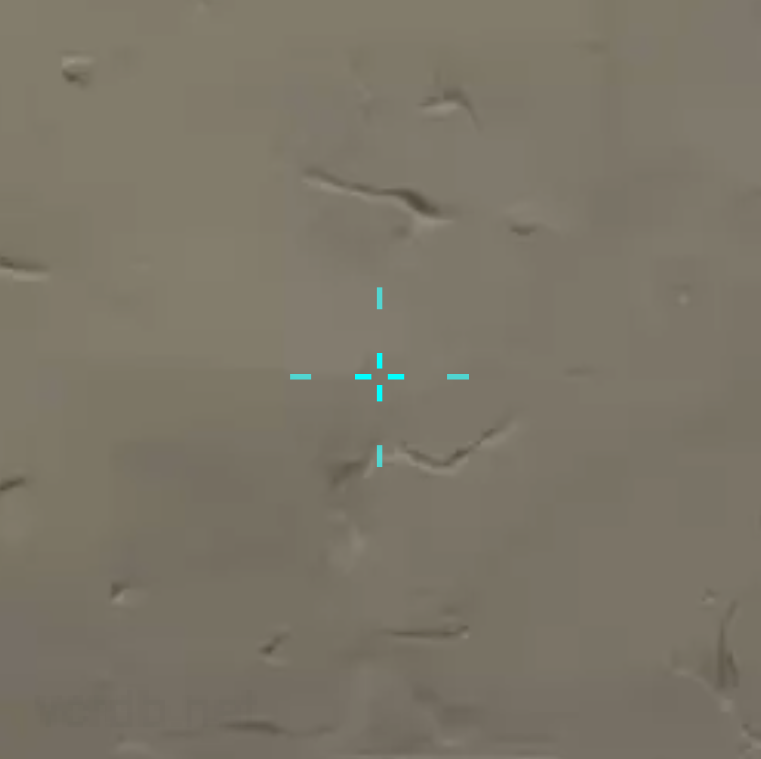
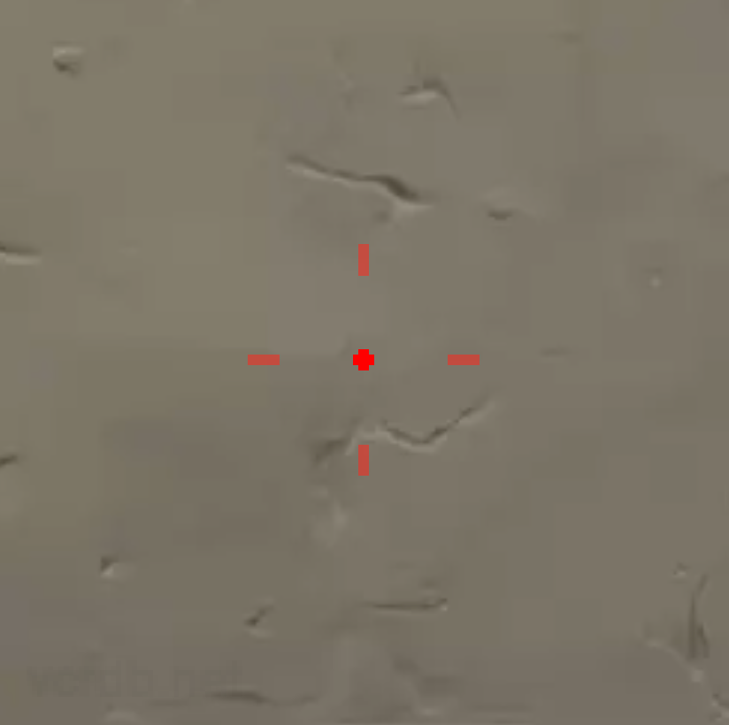

# Beast's Crosshair Compendium: The "Double Edge" Reticle System

> ⚡ **Quick-Reference Cheat Sheet:** Jump to **[CHEATSHEET.md](CHEATSHEET.md)** for mid-match emergency resets and fast cues.  
> 📖 **Master Manual:** Read the complete mechanics guide in **[VALORANT_PRO_MOVEMENT_AND_AIM_GUIDE.md](VALORANT_PRO_MOVEMENT_AND_AIM_GUIDE.md)**.

---

## Table of Contents
* <a href="#dual-focal-architecture">The "Double Edge" Dual-Focal Architecture</a>
* <a href="#beasts-double-edge-v1-cyan">Beast's Double Edge (V1 — Cyan Micro-Cross)</a>
* <a href="#beasts-double-edge-v2-red">Beast's Double Edge 2 (V2 — Red Dot Bracket)</a>
* <a href="#profile-comparison-matrix">Side-by-Side Comparison Matrix</a>
* <a href="#resolution-and-outline-tuning">Resolution Scaling & Enemy Outline Synergy</a>
* <a href="#how-to-import">How to Import Crosshair Codes in Valorant</a>

---

<a id="dual-focal-architecture"></a>
## 🧠 The "Double Edge" Dual-Focal Architecture

In competitive tactical shooters, crosshair design forces players into an age-old dilemma:

```
[ PURE DOT RETICLE ]                      [ STANDARD CROSSHAIR ]
• Minimal visual obstruction             • Strong peripheral anchor
• Pinpoint long-range 1-taps              • Natural spray pull-down boundary
✖ Zero recoil leveling horizon            ✖ Blots out 30m+ head hitboxes
✖ Dot disappears in chaotic sprays        ✖ Center clutter disrupts micro-aim
```

The **"Double Edge"** system resolves this dilemma by implementing a **Dual-Focal Layered Hierarchy**:

```
                       │ (Top Bar: Vertical Recoil Pull-Down Guide)
                       │
               ──  [ · ]  ──  (Center: 100% Solid Foveal Focus / Zero Head Occlusion)
                       │
                       │
                  (Outer Bars: Ghosted Opacity Leveling Horizon)
```

### 1. Foveal Vision (Primary Edge: Precision 1-Taps)
The human eye's fovea centralis covers only $\approx 1^\circ\text{–}2^\circ$ of central vision. At long range ($30\text{m}+$, such as Breeze Mid or Ascent A-Long), an enemy head is an $8\times 8$ pixel target.
* Traditional crosshairs occlude the head and neck, forcing the brain to guess where the true center pixel lies.
* The Double Edge system keeps the center element extremely compact at **100% solid opacity (`1.0`)**, guaranteeing absolute pixel-level target acquisition for opening deadzone 1-taps without obscuring silhouettes.

### 2. Peripheral Vision (Secondary Edge: Spray Pull-Down & Leveling)
When a rifle reaches bullets 4 through 9, vertical recoil climbs and horizontal bloom begins. The center dot is no longer where bullets impact:
* In a pure dot setup, players suffer **diagonal drift** during pull-down because a bare dot offers zero horizontal axis reference.
* The Double Edge outer bars (set at offsets `12` and `16`) provide an immediate **spatial horizon**:
  * **Horizontal Leveling:** Left and right bars keep the mouse hand on a pure vertical pull-down track.
  * **Vertical Offset Benchmark:** The top bar functions as a physical reference for pull-down depth against the enemy torso.

### 3. The Alpha Attenuation Principle (0.52 / 0.69 Opacity Hierarchy)
The outer bars are deliberately rendered with reduced opacity (**0.69** on V1, **0.52** on V2):
* Your conscious focus locks purely onto the solid center during opening shots.
* The outer bars register subconsciously in peripheral vision during spray commits without creating visual clutter or blinding you to secondary enemies in background angles.

---

<a id="beasts-double-edge-v1-cyan"></a>
## 🎯 Beast's Double Edge (V1 — Cyan Micro-Cross)



> **Core Identity:** High-contrast, tight recoil cage paired with a microscopic 4-tick center box. Engineered for fast rifle micro-adjustments, rapid burst-strafe resets, and Phantom spray transfers.

### Import Code
```text
0;p;0;s;1;P;c;5;u;2AFF00FF;h;0;f;0;0t;1;0l;3;0v;3;0g;1;0o;1;0a;1;0f;0;1t;1;1l;4;1v;4;1o;12;1a;0.69;1m;0;1f;0;A;o;1;d;1;0b;0;1b;0;S;s;1.373
```

### In-Game Configuration Matrix

| Category | Parameter | In-Game Value | Technical Function |
| :--- | :--- | :--- | :--- |
| **General** | **Color** | **Cyan (`c;5`)** | Maximum clarity and high visibility across diverse lighting conditions. |
| | **Outlines** | **OFF (`h;0`)** | Eliminates visual bulk; keeps line edges razor sharp. |
| | **Center Dot** | **OFF** | Center is formed by tight inner lines rather than a circle bead. |
| **Inner Lines** | **Show Inner Lines** | **ON** | Forms the micro-cross focal point. |
| | **Opacity / Thickness** | **1.0 / 1** | Single-pixel crisp line width with maximum opacity. |
| | **Length (H / V)** | **3 / 3** | Creates a compact 3-pixel crosshair around the center. |
| | **Offset** | **1** | Leaves a 1-pixel hollow center for unobstructed head alignment. |
| **Outer Lines** | **Show Outer Lines** | **ON** | Forms the peripheral spray bounding box. |
| | **Opacity / Thickness** | **0.69 / 1** | Semi-transparent alpha keeps outer bars secondary to center vision. |
| | **Length (H / V)** | **4 / 4** | 4-pixel bars defining outer boundaries. |
| | **Offset** | **12** | Tight recoil bracket calibrated for rapid burst recovery. |

### Tactical Application
* **Primary Weapons:** Phantom, Vandal, Spectre.
* **Playstyle:** Aggressive entry riflers who need immediate confirmation on deadzone headshots combined with tight peripheral framing for close-to-medium spray transfers.

---

<a id="beasts-double-edge-v2-red"></a>
## 🎯 Beast's Double Edge 2 (V2 — Red Dot Bracket)



> **Core Identity:** Ultra-clean solid center bead paired with an expansive, ghosted peripheral bracket. Engineered for first-bullet Vandal headshots, Sheriff/Guardian pixel peeks, and wide recoil containment.

### Import Code
```text
0;p;0;s;1;P;c;7;u;2AFF00FF;h;0;d;1;z;1;f;0;0t;4;0l;1;0v;1;0g;1;0o;0;0a;1;0f;0;1l;6;1v;6;1o;16;1a;0.52;1m;0;1f;0;A;c;7;o;0;0t;4;0l;1;0v;1;0o;0;0a;1;0f;0;1b;0;S;s;1.34;o;1
```

### In-Game Configuration Matrix

| Category | Parameter | In-Game Value | Technical Function |
| :--- | :--- | :--- | :--- |
| **General** | **Color** | **Red (`c;7`)** | Sharp visual pop and distinct chromatic separation against enemy targets. |
| | **Outlines** | **OFF (`h;0`)** | Preserves pure color saturation without black border artifacts. |
| | **Center Dot** | **ON (`d;1`, Size `1`)** | Physical dot baseline in the exact center pixel. |
| **Inner Lines** | **Show Inner Lines** | **ON** | Layers directly over center dot to create a solid circular/block bead. |
| | **Opacity / Thickness** | **1.0 / 4** | 4-pixel thickness creates a solid, punchy center dot. |
| | **Length (H / V)** | **1 / 1** | Minimum length reinforces the dot without extending lines outward. |
| | **Offset** | **0** | Zero offset centers the mass completely on the crosshair origin. |
| **Outer Lines** | **Show Outer Lines** | **ON** | Forms the expansive peripheral spray containment bracket. |
| | **Opacity / Thickness** | **0.52 / 1** | Deep attenuation (0.52) prevents visual clutter during tracking. |
| | **Length (H / V)** | **6 / 6** | Extended 6-pixel bars providing pronounced horizontal leveling. |
| | **Offset** | **16** | Wide standoff distance allows complete focus on the center bead. |

### Tactical Application
* **Primary Weapons:** Vandal, Guardian, Sheriff, Marshal.
* **Playstyle:** Precision clickers and anchor defenders holding long-distance off-angles where 1-tap headshot precision is king, with a ghosted outer bracket available whenever an engagement degenerates into a committed spray.

---

<a id="profile-comparison-matrix"></a>
## ⚖️ Side-by-Side Comparison Matrix

| Attribute | **Beast's Double Edge (V1)** | **Beast's Double Edge 2 (V2)** |
| :--- | :--- | :--- |
| **Color** | **Cyan** (`c;5`) | **Red** (`c;7`) |
| **Center Focus** | Hollow 1px micro-cross box (`1-3-1-1`) | Solid punchy center bead (`d;1` + `4-1-0-1`) |
| **Outer Offset** | **12** (Compact cage) | **16** (Wide bracket) |
| **Outer Length** | **4** | **6** |
| **Outer Opacity** | **0.69** (Moderate ghosting) | **0.52** (Heavy ghosting) |
| **Dynamic Feel** | Rapid burst reset & micro-corrections | Uncompromising center-dot discipline |
| **Recoil Utility** | Phantom burst-to-spray transitions | Vandal 2-shot burst cutoff & emergency spray leveling |

---

<a id="resolution-and-outline-tuning"></a>
## 🛠️ Resolution Scaling & Enemy Outline Synergy

### Resolution Scaling Guidelines
* **1080p (Native Reference):**
  * Use the stock profiles as documented above.
* **1440p (2K Display):**
  * Pixel density is higher. If the center focal point feels too small on 1440p:
    * *V1 Cyan:* Increase Inner Length from `3` to `4` (or Inner Thickness to `2` if line clarity fades).
    * *V2 Red:* Increase Outer Offset from `16` to `18`–`20` to maintain proportional peripheral spacing.
* **Stretch Resolution (e.g., 1280x960 / 4:3 stretched):**
  * Horizontal pixels stretch across the display. The outer bars will appear wider and further apart. Reduce Outer Offset by 2 ticks (V1: `10`, V2: `14`) to prevent the bracket from escaping peripheral vision.

### Enemy Highlight Color Synergy
* **Yellow Outlines (Pro Standard):**
  * Both **Cyan (V1)** and **Red (V2)** offer exceptional contrast against Yellow outlines. Red provides the highest chromatic separation (warm red vs bright yellow-green).
* **Purple / Deuteranopia Outlines:**
  * **Cyan (V1)** provides maximum contrast against Purple outlines across all lighting conditions.
* **Red Outlines:**
  * If using Red enemy outlines, switch your crosshair profile to **Cyan (V1)** to avoid color blending during headshot tracking.

---

<a id="how-to-import"></a>
## 📋 How to Import Crosshair Codes in Valorant

1. Launch Valorant and open **Settings** (`Esc` $\rightarrow$ gear icon in top right).
2. Navigate to the **Crosshair** tab $\rightarrow$ **Primary** sub-tab.
3. Look for the **Crosshair Profile** dropdown.
4. Click the **Import Profile Code** icon (downward-facing arrow inside a box next to the profile dropdown).
5. Paste the profile code into the text input box and click **Import**.
6. Rename the profile to **Beast's Double Edge** or **Beast's Double Edge 2**.

---

[⬅️ Back to Quick-Reference Cheat Sheet](CHEATSHEET.md) | [📖 Read Comprehensive Movement & Aim Guide ➡️](VALORANT_PRO_MOVEMENT_AND_AIM_GUIDE.md)
